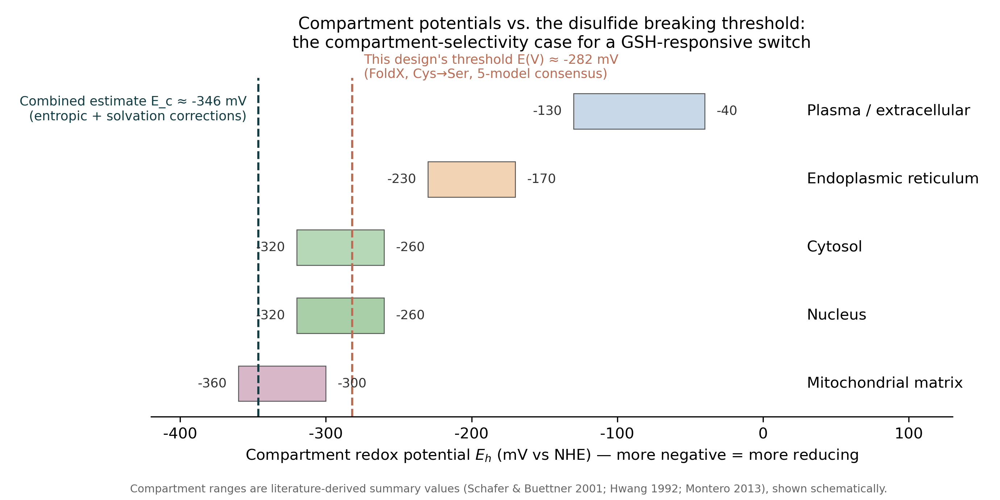
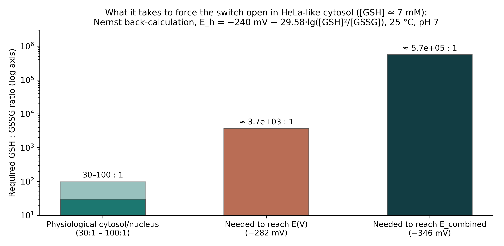
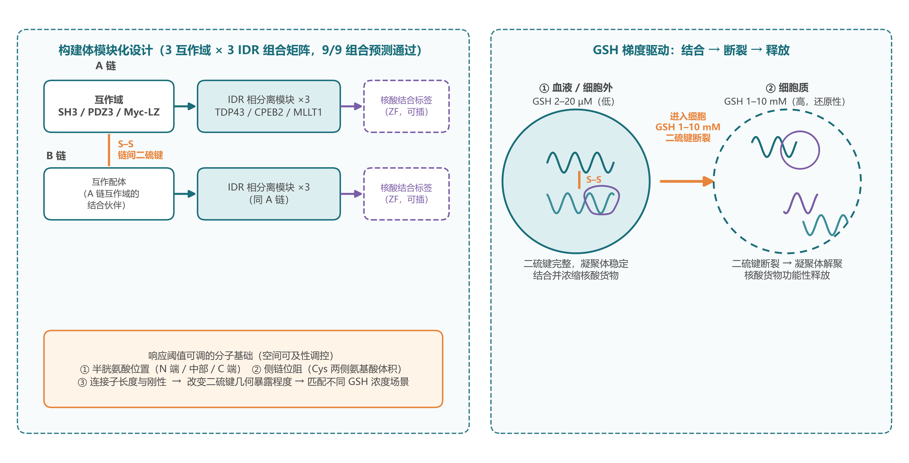
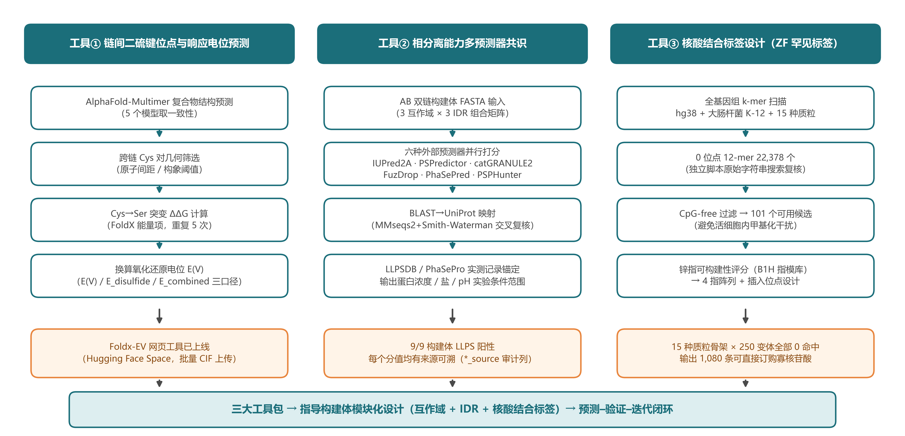

# nucleark-disulfide-trigger — the complete disulfide engineering record

**NucleArk — Tsinghua iGEM 2026.** Everything the dry lab produced on the
disulfide-bond release trigger for our condensate-based nuclear-delivery
system, in one place. The [project wiki](https://2026.igem.wiki/tsinghua)
keeps the story to one paragraph and links here; this repository holds the
full quantitative case, the tool that produced it, the molecular library it
anchored, and the complete Chinese materials pack.

What is here:

- **§1–4** — the threshold analysis that moved the design: the breaking
  potential of the designed bond, matched against the cell's compartment
  potentials, and the Nernst back-calculation of what forcing it open would
  cost. This is the quantitative case for why the release trigger became
  light, not chemistry.
- **§5** — **FoldX-EV**, the redox-potential calculator we built to produce
  §1: local pipeline + deployed web tool (upload a CIF, get millivolts).
- **§6** — the tunable-threshold molecular library the analysis anchored:
  construct matrix, six-predictor LLPS consensus panel, sequences.
- **§7** — the complete 学推 poster pack (Chinese): four-column narrative,
  design-toolkit figures, ZF nucleic-acid-binding charts, pDNA-binding scans.

Scope note: this is the **design-level analysis only**. The safety conclusion
itself is carried by the wet lab's BSO toxicity experiment (mainline T1),
which is referenced below but not interpreted here.

---

## 1 · The bond — from "does it break" to "how many millivolts"

We generated five AlphaFold-Multimer conformation models of the 1ORO-scaffold
double-strand construct, mutated each inter-chain cysteine pair to serine, and
used FoldX to compute the folding free-energy change of removing the disulfide.
Converted through

**E(V) = −ΔΔG / (23.06 × n_cys)**  (n_cys = 2)

the breaking potential of the designed bond is:

| Quantity | Value | Five-model spread |
|---|---|---|
| **E(V)** (strict threshold) | **≈ −282 mV** | −277 to −287 mV |
| **E_combined** (entropic + solvation corrections) | **≈ −346 mV** | −342 to −351 mV |

The more negative the number, the more reducing an environment must be to open
the switch. This pair of values is the quantitative anchor around which the
tunable-threshold molecular library was designed (§6; nine-construct LLPS
predictions in [`data/llps_predictions_9_constructs.csv`](data/llps_predictions_9_constructs.csv)).

Raw FoldX output (all energy terms per model):
[`data/foldx_ev_raw_1oro_constructs.tsv`](data/foldx_ev_raw_1oro_constructs.tsv).

## 2 · The environment — the cell already ships a potential gradient

Compartments are not electrically interchangeable. Plasma/extracellular fluid
sits around −40 to −130 mV; the endoplasmic reticulum (oxidative folding) around
−170 to −230 mV; the cytosol and nucleus are the most reducing compartments,
around −260 to −320 mV, sustained by a millimolar glutathione (GSH) pool that is
essentially absent from blood (blood 2–20 µM vs. cytosol 1–10 mM, ≈10³× gradient;
cytosolic/nuclear GSH/GSSG 30–100 : 1 vs. ER ≈1–3 : 1).

The designed threshold of −282 mV lands inside that intracellular window:
closed in the bloodstream, closed through the secretory pathway, opened by the
endogenous GSH gradient on arrival in the cytosol or nucleus — with no external
manipulation at all. That is the design argument for a GSH-responsive switch,
and it is why the response threshold was made tunable rather than fixed: the
margin between threshold and environment is a design variable.



## 3 · The counterfactual — forcing the switch open is expensive, and blind

The alternative to riding the endogenous gradient is to push the environment
past the threshold yourself. The Nernst relation for the GSH/GSSG couple,

**E_h = −240 mV − 29.58·lg([GSH]²/[GSSG])**  (25 °C, pH 7),

states exactly what that costs in HeLa-like cytosol ([GSH] ≈ 7 mM):

| Target potential | Required GSH : GSSG ratio | vs. physiological (30–100 : 1) |
|---|---|---|
| −282 mV (E(V), strict threshold) | ≈ 3.7 × 10³ : 1 (GSSG ≤ 1.9 µM) | 37–120 × higher |
| −346 mV (E_combined) | ≈ 5.7 × 10⁵ : 1 (GSSG ≤ 12 nM) | ~4 orders of magnitude higher |

Two conclusions follow.

1. **The threshold sits at or beyond the edge of what physiology reaches**:
   any systemic redox reprogramming — perfusion with strong reductants, GSH
   esters, genetic depletion of the glutathione pool — has to buy a shift two
   to four orders of magnitude larger than normal biological fluctuation.
2. **The manipulation is blind to compartments**: a cytosol dragged to
   −346 mV has crossed the mitochondrial matrix potential and will scramble the
   ER's oxidative folding chemistry at the same time. The wet lab's mild
   pharmacological probe of the same axis (BSO, which depletes GSH) produces a
   clear toxicity phenotype — an empirical echo of how narrow this control
   window is.



## 4 · Design decision — why the trigger became light

The disulfide analysis did what a good negative result should do: it moved the
design. A redox trigger can be made selective on paper, but the only entity
allowed to pull the trigger is the cell's own gradient — which means the release
time and place cannot be chosen, only received. Light needs no such compromise:
it deposits no chemistry, shifts no potentials, and is switched by the
experimenter. That reasoning, together with the robustness of the CORdensate
photo-switchable condensation module (Li Pilong's lab, Tsinghua) across fusion
partners, is why NucleArk's final design couples condensation to illumination
rather than to glutathione.

---

## 5 · FoldX-EV — the potential calculator, local and online

The numbers in §1 were produced with a pipeline we built out and then packaged
as a public web tool, so the wet lab (or anyone) can price their own disulfides
without a local FoldX setup.

**Online (recommended)**: [Foldx-EV on Hugging Face Spaces](https://huggingface.co/spaces/kalendar114/Foldx-EV)
— upload one or more `.cif` files, press Submit, get a result table with
`n.cys`, total Cys→Xaa ΔΔG (kcal/mol) and E(V); downloadable as
`final_result.txt`. Gradio front-end, Docker deployment.

**Method**: convert input structures to PDB, let FoldX mutate every cysteine
involved in the interface, sum the folding free-energy changes into ΔΔG, and
convert via E(V) = −ΔΔG / (23.06 × n_cys). |E(V)| larger ⇒ the disulfide
contributes more stability ⇒ harder to break ⇒ higher response threshold.

**Contents of [`pipeline/`](pipeline/)**:

| File | Role |
|---|---|
| [`README.md`](pipeline/README.md) | Bilingual usage doc (online + local + Space deployment) |
| [`cif2pdb.py`](pipeline/cif2pdb.py) / [`mmcif2pdb.py`](pipeline/mmcif2pdb.py) | Batch CIF/mmCIF → PDB conversion |
| [`detect_ssbond.py`](pipeline/detect_ssbond.py) | Detect existing disulfide bonds in a structure |
| [`afoldx.sh`](pipeline/afoldx.sh) | Core FoldX batch analysis script |
| [`compute_stats.awk`](pipeline/compute_stats.awk) | Statistics over repeated runs: E(V), E_disulfide, E_combined with SDs |
| [`hf_space/`](pipeline/hf_space/) | The Space itself: `app.py` (Gradio UI), `pipeline.sh`, `Dockerfile`, `requirements.txt`, `push_to_hf.py`, `upload_foldx.py` |

Running the local pipeline needs Linux, the FoldX binary (free academic
license from [foldxsuite.crankit.nl](https://foldxsuite.crankit.nl/) — not
redistributed here), and [pdb-tools](https://github.com/haddocking/pdb-tools)
for the CIF→PDB step.

**Validation**: the pipeline was benchmarked on **insulin** — a classic
disulfide-containing protein with a literature-known redox behaviour — across
five repeated FoldX runs; `compute_stats.awk` collapses the runs into
E(V) / E_disulfide / E_combined with standard deviations against the
literature baseline of −0.220 V for insulin's disulfides.

**Mutation-choice note**: the web tool performs the generic CYS→ALA scan
documented in [`pipeline/README.md`](pipeline/README.md); the §1 construct
analysis refined this to **Cys→Ser** (serine is the more physiologically
neutral "disulfide removed" replacement) and takes the consensus over five
AlphaFold-Multimer models instead of a single structure. That refinement path,
with the reasoning, is recorded in the poster pack
([§2.1 of `poster_pack/海报材料_二硫键与核酸结合.md`](poster_pack/海报材料_二硫键与核酸结合.md)).

## 6 · The tunable-threshold molecular library

The §1–4 analysis fixed one more thing besides the pivot: if a redox trigger
is ever used, its threshold must be a **design variable**, not a fixed point.
The library therefore modularizes the construct into three independently
designable, combinatorially screenable modules:

- **Interaction domain (carries the inter-chain disulfide)** — determines
  pairing, where the bond forms, and how hard GSH must work (the threshold);
- **IDR condensation module** — determines condensate formation propensity
  and concentration window (loading capacity);
- **Nucleic-acid-binding tag (zinc-finger array etc.)** — determines binding
  specificity and stoichiometry toward the cargo (cargo capture).

Threshold tunability comes from **spatial accessibility engineering**:
systematically varying the parameters around the disulfide (cysteine position,
side-chain steric bulk, linker length and rigidity) sweeps the response
threshold across the "too sensitive → too stable" continuum.



**Construct matrix screened**: 3 interaction domains (SH3 / PDZ3 / Myc-LZ) ×
3 IDRs (TDP43 / CPEB2 / MLLT1) = 9 double-strand constructs, evaluated with a
six-predictor LLPS consensus pipeline (IUPred2A, PSPredictor, catGRANULE2,
FuzDrop, PhaSePred, PSPHunter; BLAST + MMseqs2/Smith-Waterman dual mapping;
results anchored to measured records in LLPSDB / PhaSePro):

- **9/9 constructs predicted LLPS-positive, 9/9 support an inter-chain
  disulfide**; FuzDrop p(LLPS) 0.9385–0.9995, PSPredictor 0.839–0.9991.
  The first-generation 1ORO-scaffold constructs are also all positive
  (consensus 1.000) — the conclusion is not scaffold-sensitive.
- **Measured-condition anchoring** (guides wet-lab replication directly):

| Construct family | LLPSDB records | Condition range |
|---|---|---|
| + **TDP43** | 5 measured | 2–50 µM protein; 25–150 mM salt; pH 7.4–7.5; 25 °C |
| + **MLLT1** | 2 measured | 20 µM protein; 10–300 mM salt |
| + **CPEB2** | none | use predicted screening range (20–150 µM; 50–300 mM; pH 6.0–8.5) |

Raw panel output:
[`data/llps_predictions_9_constructs.csv`](data/llps_predictions_9_constructs.csv)
(every score keeps a `*_source` provenance column; a missing FuzDrop token is
recorded as *skipped*, never imputed).

Construct sequences: [`data/sequences/`](data/sequences/) — `1ORO.fasta`
(first-generation scaffold), `1ORO_NLSed.fasta` (NLS-appended variant),
`1ORO_NLSed_LLPSed_NLSed_LLPSed.fasta` (iterated construct), and
`interaction_disulfide_3IDR_1NLS.fasta` (interaction-domain + IDR construct
of the nine-construct panel).

**Planned next iterations** (recorded in the poster pack, §4): a disulfide
variant library sweeping the accessibility parameters with measured breakage
half-lives and selectivity indices under simulated physiological/pathological
GSH gradients; QSAR + active learning toward inverse design ("give me a
threshold, get a spacer"); intracellular validation with rxYFP sensors and
BSO-titrated GSH-gradient cell lines.

## 7 · The 学推 poster pack — complete Chinese materials

[`poster_pack/`](poster_pack/) is a verbatim mirror of the curated materials
pack for the 2026 学术推进计划 mid-term poster (disulfide engineering +
nucleic-acid binding, dry-lab supply version):

- [`海报材料_二硫键与核酸结合.md`](poster_pack/海报材料_二硫键与核酸结合.md) —
  the full four-column poster narrative (background / methods & methodological
  iterations / delivered results / future plan), each section in complete and
  trimmed (poster-length) versions, with **Appendix A** mapping every number
  to its source file. If you read only one document, read this one.
- [`素材清单README.md`](poster_pack/素材清单README.md) — figure-by-figure
  inventory with usage notes and framing caveats.
- [`素材库/`](poster_pack/素材库/) — the figures and tables themselves:
  `01_申请书插图/` (the design-framework overview), `02_ZF图表/`
  (six figures for the zinc-finger rare-tag module), `04_pDNA结合/`
  (pDNA binding-site landscape + copy-number scan), `05_新绘示意图/`
  (figA construct architecture + figB toolkit overview, regenerable via
  `draw_diagrams.py`), `06_结果表/` (the result tables, same data as
  [`data/`](data/) under Chinese filenames).

Highlights the pack carries beyond §1–6:

- **ZF rare-tag module** (nucleic-acid binding): 22,378 human-genome
  zero-hit 12-mers → 101 CpG-free candidates → 0 hits across 15 common
  plasmid backbones × 250 tag variants (incl. lentiviral packaging plasmids)
  → recommended tag `GGTCCACTACTA` drops human-genome binding sites from
  3,462 to 31 (≈112×), scored buildable as a 4-finger array against the
  Princeton B1H framework → 24 safe insertion sites and 1,080 directly
  orderable oligonucleotides. (The full ZF pipeline lives with the team's
  sequence-design work; this pack carries the poster-facing figures.)
- **pDNA–protein binding model**: per-motif-site Kd and bound-protein
  layer count per plasmid, with the condensate-concentration gain —
  the quantitative "condensation boosts nucleic-acid binding" story
  (`04_pDNA结合/`). Framing caveat: the model's original narrative was
  attached to NLS nuclear-entry; per the pack's agreement the nuclear-entry
  framing is stripped here ([§2.4 of the poster doc](poster_pack/海报材料_二硫键与核酸结合.md)).
- **figB toolkit overview**: the three dry-lab toolkits (E(V) calculator /
  LLPS consensus panel / nucleic-acid-binding tag pipeline) as one figure:



---

## Repository layout

```
figures/      threshold-analysis figures (EN main + ZH originals)
code/         make_figures.py — regenerates both English figures
data/         foldx_ev_raw_1oro_constructs.tsv — raw FoldX output, 5 models, all terms
              llps_predictions_9_constructs.csv — six-predictor LLPS panel, 9 constructs
              sequences/ — construct FASTAs (see §6)
pipeline/     FoldX-EV: bilingual usage doc, local scripts, HF Space app (§5)
poster_pack/  学推 poster pack: narrative + inventory + 素材库 figures (§7, Chinese)
docs/         D1_wiki_copy_zh.md — the original Chinese write-up of §1–4
```

## Reproduce

```bash
python code/make_figures.py     # §1–4 figures; needs numpy + matplotlib
python poster_pack/素材库/05_新绘示意图/draw_diagrams.py   # figA/figB
# FoldX-EV pipeline: see pipeline/README.md (local) or use the online Space
```

## Provenance & caveats

- FoldX values (§1): 1ORO-scaffold construct, **Cys→Ser** mutation, five
  AlphaFold-Multimer models (`data/foldx_ev_raw_1oro_constructs.tsv`). The
  web tool's generic scan is CYS→ALA — see the note in §5.
- Compartment redox ranges are **literature-derived summary values**
  (Schafer & Buettner 2001; Hwang 1992; Montero 2013), shown schematically in
  the figures — re-verify against the original papers before citing the ranges
  in a publication.
- Nernst coefficient 29.58 mV/decade valid at 25 °C, pH 7, two-electron transfer.
- Every number in the poster pack has a source-file mapping in **Appendix A**
  of [`poster_pack/海报材料_二硫键与核酸结合.md`](poster_pack/海报材料_二硫键与核酸结合.md).
- Deliberately **not** included here: the FoldX binary (license — download
  from the FoldX suite site), three copyrighted literature PDFs (listed below
  by title only), and the team's internal 学推 application full text.
- The Chinese write-up in `docs/` is the source §1–4 were first drafted in;
  numbers are identical.

## Key literature (titles; PDFs not redistributed)

1. 《通过谷胱甘肽二硫化物、谷胱甘肽对的氧化还原状态观察细胞的氧化还原环境》 —
   compartment redox environments via the GSH/GSSG couple; the basis of the
   §2 potential ranges (Schafer & Buettner 2001 lineage).
2. 《通过微环境效应及复杂氧化还原环境中分析对二硫化物稳定性的广泛调控》 —
   tuning disulfide stability through microenvironment effects in complex
   redox settings; the basis of the spatial-accessibility design strategy (§6).
3. 《含二硫化物的注射递送系统及其氧化还原生物命运》 — injectable
   disulfide-containing delivery systems and their redox biological fate;
   background for the "closed in the bloodstream" argument (§2).

## License

MIT — see [LICENSE](LICENSE).
